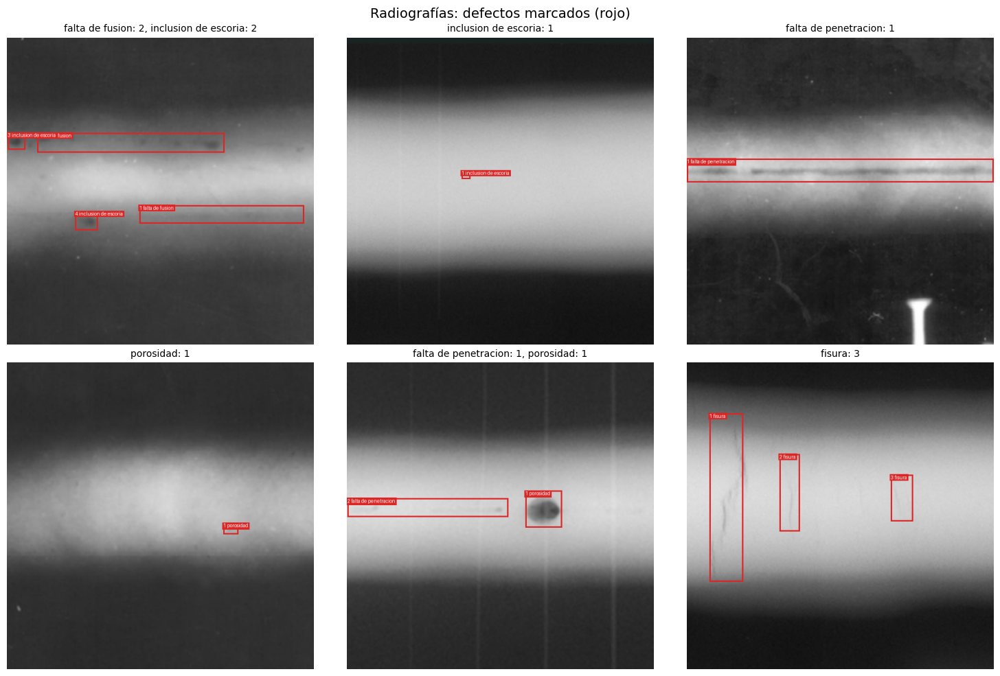

# Revisión remota de soldaduras con IA

Herramienta para que un inspector de soldaduras de ductos revise y apruebe radiografías **a distancia**. El técnico sube las placas desde la obra, un modelo de visión por computadora marca y ordena las zonas sospechosas, y el inspector decide.

> **La IA no aprueba nada: prioriza.** Está calibrada para que casi no se le escapen defectos, aunque eso implique algunas falsas alarmas. La decisión y la firma son siempre del inspector certificado.

**Demo pública:** https://scheffan.github.io/weld-inspection-ai/ (repo `scheffan/weld-inspection-ai`, solo la app armada y los modelos).

## Estado

| Etapa | Qué incluye | Estado |
|---|---|---|
| 0. Base | Estructura, preprocesamiento, tests, CI | ✅ |
| 1. Datos | Descarga segura, duplicados, nombres unificados, split sin fuga | ✅ 2.699 radiografías y 993 fotos de cordones distintas |
| 2. Modelo | Detector RT-DETR (Apache 2.0) con ventanas para placas alargadas | ✅ radiografías: mAP@50 0,648, 95,6 % de placas con defecto marcadas · fotos de cordones: mAP@50 0,549, 97,7 % de fotos con defecto marcadas |
| 3. Visualización | Recuadros rojos (defecto), ámbar (cordón malo) y verdes (bien), con conteo | 🟡 módulo de dibujo listo |
| 4. App | App web (modelos en el navegador): analizar → carga de juntas → bandeja → revisión → decisión → informe PDF → auditoría | 🟡 carga de juntas, bandeja por riesgo, revisión, decisión, informe PDF e historial (web/). Falta calibrar rojo/amarillo |
| 5. QA | Historias de usuario, casos de prueba, tests e2e | 🟡 historias listas |
| 6. Difusión | Demo pública y documentación | ⏳ |

## Estructura

```
src/revision_pipes/   código del proyecto
app/                  app Streamlit
tests/                tests automáticos (pytest)
data/                 datasets (no se suben, ver data/README.md)
notebooks/            notebook de Kaggle (se genera con scripts/build_kaggle_notebook.py)
scripts/              utilidades del proyecto
docs/                 bitácora con capturas, licencias de datos y documentación QA
```

## Cómo correrlo

Requiere Python 3.10 o superior.

```bash
python -m venv .venv
# Windows: .venv\Scripts\activate    ·    Linux/Mac: source .venv/bin/activate
pip install -e ".[dev,app,model]"

pytest                               # tests
python scripts/instalar_modelos.py   # copia los modelos desde los .zip de Kaggle a models/
streamlit run app/streamlit_app.py   # app vieja (Streamlit)
```

App web (requiere Node 20+):

```bash
cd web
npm install
npm run dev        # copia los modelos de ../models y abre la app en http://localhost:5173
npm test           # pruebas gemelas contra Python y reglas de juntas
```

Pruebas de punta a punta con Chrome (con `npm run build && npx vite preview --port 4173`): `python e2e/inspector.py <ejemplos> <capturas>` (flujo completo del inspector) y `python e2e/analizar.py <ejemplos> <capturas>`.

## Datos

| Dataset | Qué aporta | Licencia |
|---|---|---|
| Radiografías "weld" y "weld data" (Roboflow) | 2.742 radiografías con defectos marcados (porosidad, fisura, escoria, falta de penetración y de fusión, entre otros) | CC BY 4.0 |
| Fotos de cordones (Roboflow) | Recuadros de cordón bueno, cordón malo y defecto | CC BY 4.0 y dominio público |
| GDXray (Welds) | Evaluación con otra fuente (más adelante) | Solo investigación y educación |



Las imágenes no se incluyen en el repo. Las copias aumentadas y las fotos repetidas entre datasets se agrupan para que ninguna quede a la vez en entrenamiento y en prueba. Detalle en [`docs/licencias-datos.md`](docs/licencias-datos.md).

## Bitácora

El proceso, etapa por etapa y con capturas, está en [`docs/bitacora.md`](docs/bitacora.md).
