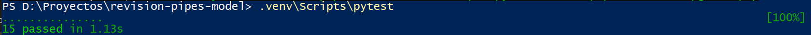

# Bitácora del proyecto

Registro de cada etapa con capturas. Es la base para el README público, la tarjeta del portfolio (ES/EN) y el proyecto en LinkedIn.

## Capturas pendientes por etapa

| Etapa | Captura | Para |
|---|---|---|
| 0 | Tests pasando en la PC local | README, LinkedIn ✅ |
| 0 | CI en verde en GitHub | README |
| 1 | Ejemplos de cada dataset con sus recuadros | README, portfolio |
| 1 | Gráfico de cantidad de imágenes por clase | README, LinkedIn |
| 2 | Curvas de entrenamiento y matriz de confusión | README |
| 3 | Radiografía con defectos marcados en rojo y zonas sanas en verde | Portada del portfolio y LinkedIn |
| 4 | App: lote ordenado por prioridad, revisión, informe PDF | Portfolio, LinkedIn |
| 5 | Tests e2e pasando | README |

---

## Etapa 0 · Base (16-nov-2026)

**Qué se hizo:** estructura del repo, primer módulo real (preprocesamiento de radiografías de 8 y 16 bits), 15 tests automáticos, esqueleto de la app en Streamlit y CI en GitHub Actions.

**Decisiones:**
- Repo privado; la vitrina pública va aparte (README público y demo).
- Los datasets no se suben al repo, por licencia y tamaño.
- La IA prioriza, no aprueba: la decisión es del inspector certificado.

**Resultado:** 15 tests pasando en la PC local y en el CI de GitHub.
