# Bitácora del proyecto

Registro de cada etapa con capturas. Es la base para el README público, la tarjeta del portfolio (ES/EN) y el proyecto en LinkedIn.

## Capturas pendientes por etapa

| Etapa | Captura | Para |
|---|---|---|
| 0 | Tests pasando en la PC local | README, LinkedIn ✅ |
| 0 | CI en verde en GitHub | README |
| 1 | Ejemplos de cada dataset con sus recuadros | README, portfolio ✅ |
| 1 | Gráfico de cantidad de imágenes por clase | README, LinkedIn ✅ |
| 2 | Curvas de entrenamiento, experto vs. modelo, dónde falla | README ✅ |
| 3 | Radiografía con defectos marcados en rojo y zonas sanas en verde | Portada del portfolio y LinkedIn |
| 4 | App: lote ordenado por prioridad, revisión, informe PDF | Portfolio, LinkedIn |
| 5 | Tests e2e pasando | README |

---

## Etapa 0 · Base (16-nov-2026)

**Qué se hizo:** estructura del repo, primer módulo real (preprocesamiento de radiografías de 8 y 16 bits), 15 tests automáticos, esqueleto de la app en Streamlit y CI en GitHub Actions.

**Decisiones:**
- Repo privado; la vitrina pública va aparte (README público y demo).
- Los datasets no se suben al repo, por licencia y tamaño.
- La IA prioriza, no aprueba: la decisión es del inspector certificado.

**Resultado:** 15 tests pasando en la PC local y en el CI de GitHub.

---

## Etapa 1 · Datos (16-nov-2026, primera corrida en Kaggle)

**Qué se hizo:** notebook de Kaggle que baja los datasets, descarta todo lo que no sea imagen o etiqueta, convierte los recuadros a un formato común, agrupa copias y duplicados, separa los conjuntos sin fuga y dibuja ejemplos.

**Hallazgo clave: muchas imágenes, pocas fotos distintas.**

| Dataset | Imágenes | Originales por nombre |
|---|---|---|
| Cordones CC BY 4.0 (Roboflow) | 3.621 | 1.299 |
| Cordones dominio público (Roboflow) | 1.000 | 703 |
| **Total después de detectar duplicados por contenido** | **4.621** | **993 fotos distintas** |

El dataset grande infla su tamaño con copias espejadas y rotadas, y los dos datasets comparten fotos. Si se separara por imagen suelta, la misma foto (o su copia rotada) caería en entrenamiento y en prueba, y las métricas saldrían infladas. Se separó por grupo de foto: 3.255 imágenes para entrenamiento, 687 para validación y 679 para prueba, y una verificación automática confirma que ningún grupo aparece en dos conjuntos.

Nota: el umbral de parecido es estricto a propósito. Puede juntar algunas fotos distintas pero muy similares, lo que hace la separación más conservadora, nunca más optimista.

Recuadros totales: 13.670 (Good Weld 5.485, Defect 4.928, Bad Weld 3.257), incluidas las copias aumentadas.

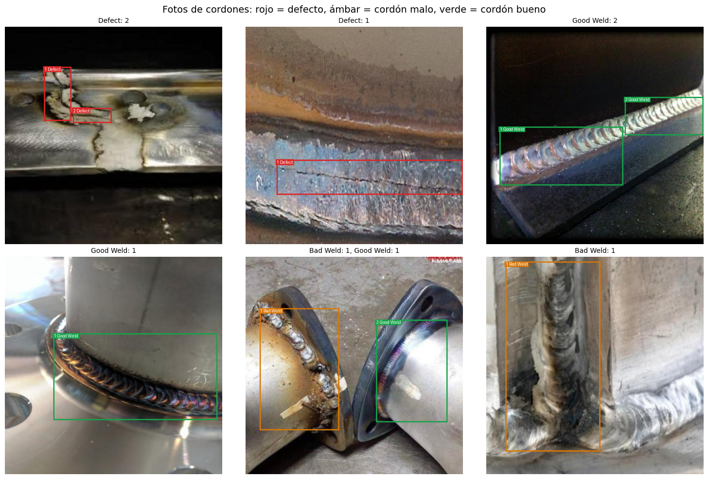

*Imágenes: datasets "Welding_Defects" (Roboflow Universe, CC BY 4.0) y "welding defects detection" (Roboflow Universe, dominio público).*

**SWRD descartado por ahora:** el zip pesa 116 GB y no tiene licencia publicada. Se reemplazó por dos datasets de radiografías de Roboflow con licencia CC BY 4.0.

### Segunda corrida (17-nov-2026): radiografías

| Dataset | Imágenes | Licencia |
|---|---|---|
| "weld" (Roboflow, versión 1 sin aumentaciones) | 2.184 | CC BY 4.0 |
| "weld data" (Roboflow) | 558 | CC BY 4.0 |
| **Total** | **2.742 → 2.699 radiografías distintas** | |

**Nombres unificados:** cada dataset nombraba los defectos distinto ("Lack Of Penetration" / "incomplete penetration", y hasta "Tungsten Inclusion" y "tungsten inclusion" como clases separadas). Un módulo con tests los lleva a 11 clases comunes en español.

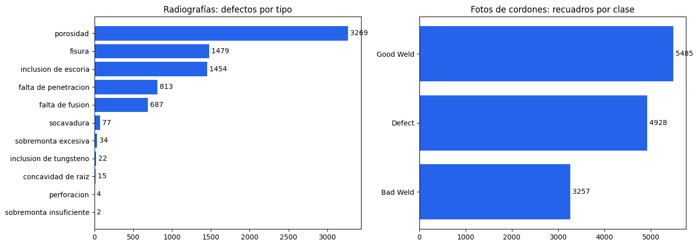

**Desbalance:** cinco defectos (porosidad, fisura, inclusión de escoria, falta de penetración y falta de fusión) concentran el 98% de los 7.856 recuadros. Las clases con menos de 100 ejemplos no alcanzan para entrenar bien; en la Etapa 2 se agrupan como "otro defecto".

**Separación:** 1.926 radiografías para entrenamiento, 408 para validación y 408 para prueba, sin fuga.

*Imágenes: datasets "weld" (kunkun) y "weld data" (Vayun Goel), Roboflow Universe, CC BY 4.0.*

**Etapa 1 terminada.**

---

## Etapa 2 · Modelo (17-nov-2026)

**Decisiones:**
- Detector **RT-DETR R18** (Apache 2.0) preentrenado, ajustado a soldaduras. No YOLO de Ultralytics: su licencia AGPL obligaría a publicar el código de la app.
- Radiografías: 5 defectos principales + **"otro defecto"**, que agrupa los seis tipos con menos de 100 ejemplos. El modelo igual avisa que hay algo y el inspector decide.
- El umbral de confianza se elige en **validación** para detectar al menos el 95% de las placas con defectos. La evaluación final se hace en **prueba**, con imágenes que el modelo nunca vio.
- Métricas: mAP@50 (estándar), recall y precisión por tipo de defecto, recall por placa (la que le importa al inspector) y galería de "dónde falla".
- Exportación a **ONNX** para que la app corra sin placa de video, verificada contra PyTorch con una radiografía real.

**Antes de gastar GPU:** el notebook completo se probó en la nube con un modelo chico y datos simulados (entrenamiento, evaluación, gráficos y exportación). Esa prueba encontró un detalle: con un modelo sin entrenar, todas las posiciones empatan en puntaje y ONNX y PyTorch desempatan distinto. Por eso la verificación final usa una imagen real y compara los hallazgos, no los números crudos.

### Primera corrida: radiografías (Kaggle, GPU T4, 2,1 h)

**Entrenamiento:** el mAP@50 en validación subió rápido (0,31 → 0,59 en 9 épocas) y llegó a su mejor valor, **0,626**, en la época 13. Después se estancó entre 0,60 y 0,62: con estos datos, el modelo ya aprendió lo principal. Se usa la época 13.

**Resultados en prueba (408 radiografías que el modelo nunca vio):**

| Métrica | Valor |
|---|---|
| mAP@50 | **0,607** (referencia publicada en SWRD: 0,66) |
| mAP@50-95 | 0,288 |
| Placas con defecto marcadas (recall por placa) | **90,4%** (369 de 408) |
| Umbral de confianza (elegido en validación) | 0,55 |

| Defecto | Recall | Precisión |
|---|---|---|
| Falta de penetración | 81% | 85% |
| Porosidad | 75% | 77% |
| Fisura | 69% | 84% |
| Inclusión de escoria | 64% | 78% |
| Falta de fusión | 45% | 62% |
| Otro defecto | 5% | 25% |

**Lectura honesta:**
- El umbral se eligió en validación para marcar el 95% de las placas con defectos, pero en prueba marcó el 90%. La calibración no se trasladó del todo: hace falta un margen de seguridad (elegir el umbral apuntando más alto en validación).
- "Otro defecto" casi no se detecta: tenía solo 120 ejemplos de entrenamiento repartidos en seis tipos distintos. Falta de fusión también es débil.
- **Limitación importante:** todas las radiografías del dataset tienen defectos, así que no se pudo medir cuántas falsas alarmas daría en placas sanas.
- La exportación a ONNX (81 MB) da exactamente los mismos hallazgos que PyTorch.

Las métricas quedan en `docs/metricas/radiografias.json` y un test del CI falla si un modelo nuevo rinde por debajo de un piso acordado.

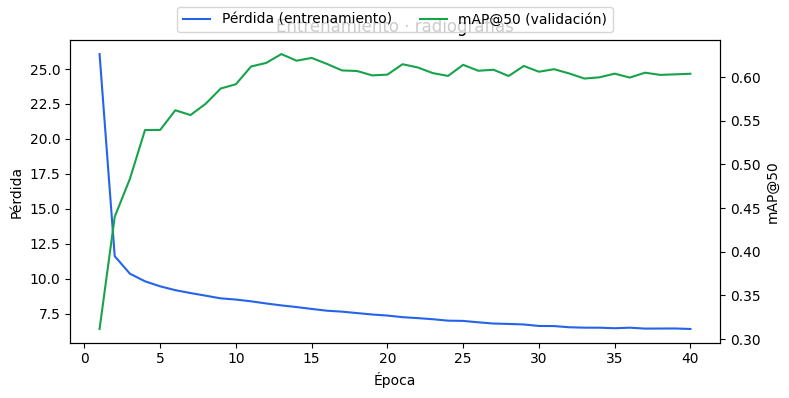

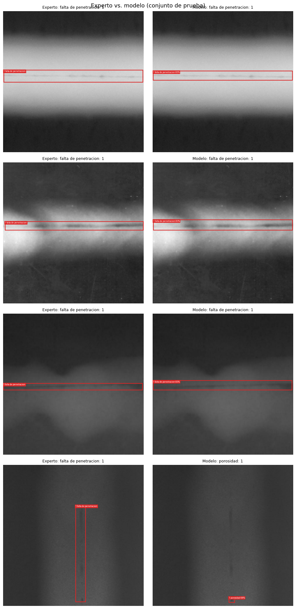

**Dónde falla (lo más valioso de la corrida):**

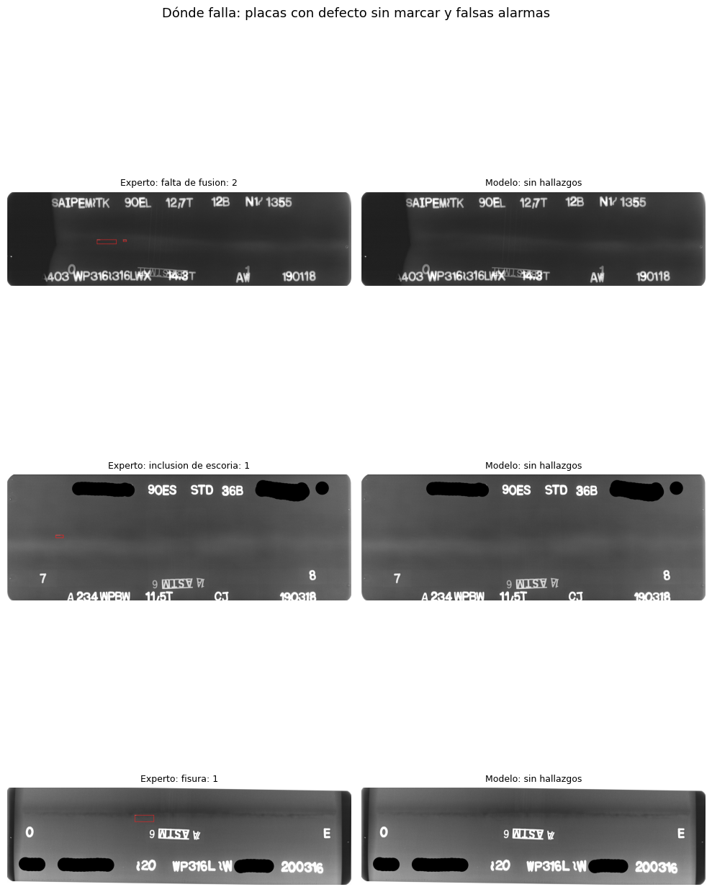

1. **Placas completas muy alargadas.** Las radiografías que se escapan son placas enteras (unas 5 veces más anchas que altas, con números y marcas de identificación) con defectos diminutos. Al achicarlas a 640×640 para el modelo, el defecto queda de uno o dos píxeles y desaparece. Solución: **recortar la placa en ventanas cuadradas superpuestas** (*tiling*) para entrenar y para detectar, y después unir los resultados.
2. **Soldaduras verticales.** Una falta de penetración vertical se confundió con porosidad: casi todas las soldaduras de entrenamiento son horizontales. Solución: sumar rotaciones de 90° a las variaciones de entrenamiento.

Estas dos mejoras atacan la causa de los errores, que es mejor que solo probar un modelo más grande.

### Segunda versión (v2): ventanas superpuestas + rotaciones

- **Ventanas:** las placas alargadas (lado largo / lado corto ≥ 1,5) se cortan en cuadrados del lado corto que se pisan un 25 %. Se entrena y se detecta por ventana; los recuadros vuelven a la placa y los duplicados se unen. Un recuadro cortado por el borde se usa solo si se ve al menos el 40 %.
- **Sin fuga:** todas las ventanas de una placa quedan en el mismo conjunto que la placa.
- **Zonas sanas:** las ventanas sin defectos permiten medir, por primera vez, cuántas falsas alarmas da el modelo en partes sanas de una placa real.
- **Rotaciones de 90°** en el 30 % de las imágenes de entrenamiento, para soldaduras verticales.
- **Umbral con margen:** en validación se apunta al 97 % de placas marcadas, para que en prueba quede cerca del 95 %.
- La app usa las mismas ventanas automáticamente cuando la imagen es alargada.
- Las métricas se siguen calculando por placa completa, así que se pueden comparar directo con la v1.

### Réplica involuntaria de la v1 (17-nov-2026, noche)

Se volvió a correr por error el notebook de la v1 (sin ventanas). Sirvió para medir cuánto varía el resultado entre dos entrenamientos con el mismo código y los mismos datos:

| Corrida | mAP@50 prueba | Placas marcadas | Umbral |
|---|---|---|---|
| v1 (primera) | 0,607 | 90,4 % | 0,55 |
| v1 (réplica) | 0,614 | 93,4 % | 0,50 |

Conclusión: diferencias de 1 punto de mAP o de 3 puntos en placas marcadas pueden ser solo azar del entrenamiento. Para decir que la v2 mejora, la diferencia tiene que ser claramente mayor que eso.

### Resultados de la v2 (ventanas + rotaciones), 18-nov-2026

Corrida en Kaggle (GPU T4, 25 épocas, 2,25 h). Mejor época: 17 (mAP@50 en validación 0,657).

| | v1 | v1 (réplica) | **v2 (ventanas)** |
|---|---|---|---|
| mAP@50 en prueba | 0,607 | 0,614 | **0,648** |
| mAP@50-95 | 0,288 | 0,285 | **0,303** |
| Placas con defecto marcadas | 90,4 % | 93,4 % | **95,6 %** (390 de 408) |
| Placas sin marcar | 39 | 27 | **18** |
| Zonas sanas con falsa alarma | sin medir | sin medir | **22 de 207 (10,6 %)** |

| Defecto | Recall v1 → v2 | Precisión v1 → v2 |
|---|---|---|
| Falta de penetración | 81 % → **87 %** | 85 % → 84 % |
| Porosidad | 75 % → **81 %** | 77 % → 74 % |
| Fisura | 69 % → **80 %** | 84 % → 74 % |
| Inclusión de escoria | 64 % → 65 % | 78 % → 80 % |
| Falta de fusión | 45 % → **53 %** | 62 % → 63 % |
| Otro defecto | 5 % → 18 % | 25 % → 20 % |

**Lectura:**
- La mejora de mAP@50 (+3,4 a +4,1 puntos) es varias veces mayor que la diferencia entre las dos corridas de la v1 (0,7 puntos), así que no es azar.
- **Se cumplió el objetivo del proyecto:** marca el 95,6 % de las placas con defectos en prueba. El margen de seguridad en validación (97 %) funcionó.
- El modelo encuentra más defectos (sube el recall en casi todas las clases) a cambio de algunas falsas alarmas más. Es el intercambio buscado: la IA prioriza y el inspector descarta.
- **Primera medición en zonas sanas:** en 1 de cada 10 trozos sanos de placa marca algo que no es. Es un dato honesto para el README y para hablar con los inspectores.
- "Otro defecto" y falta de fusión siguen siendo los puntos débiles: les faltan ejemplos.

El test de regresión del CI ahora exige el nivel de la v2 (incluido un máximo de 15 % de falsas alarmas en zonas sanas). La v1 queda guardada como referencia.

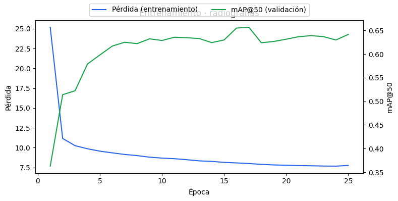

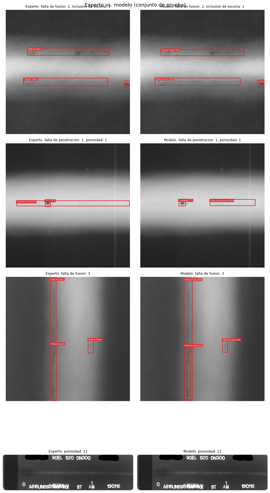

La última fila muestra justo el caso que fallaba en la v1: una placa completa y alargada con **12 poros diminutos**. Con las ventanas, el modelo marca los 12, igual que el experto.

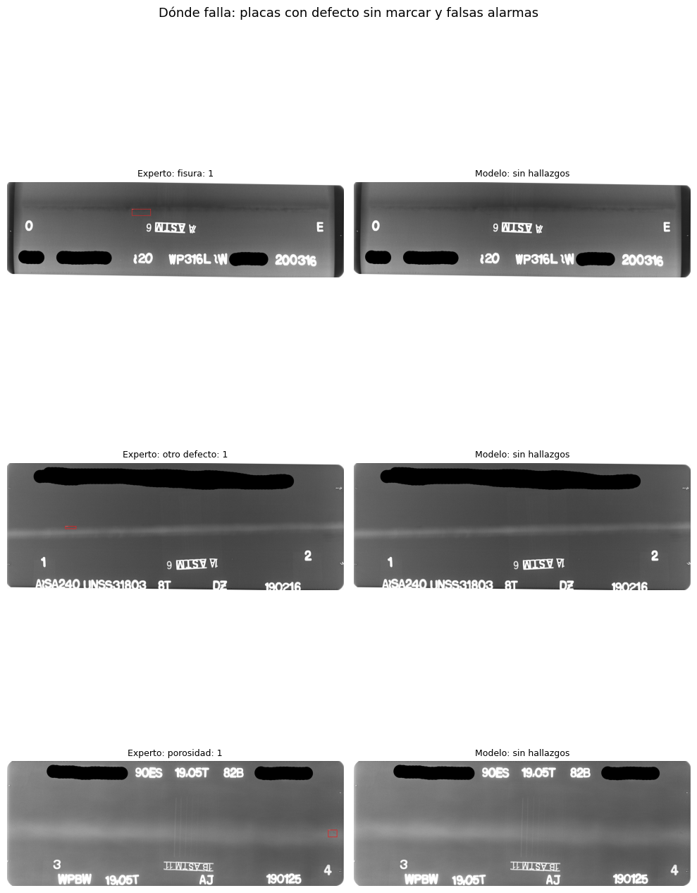

Lo que todavía se escapa: un solo defecto muy chico en una placa alargada, a veces pegado al borde. Son 18 de 408 placas.

### Fotos de cordones, primera versión (22-nov-2026)

Mismo detector y mismo notebook que radiografías, generado con `MODULO = "cordones"`. Cambios para este módulo:

- **"Cordón bueno" no cuenta como defecto.** El umbral de seguridad, el recall por imagen y las galerías miran solo "cordón malo" y "defecto".
- **Métrica nueva:** fotos sin ningún defecto real en las que el modelo igual marca uno.
- **Validación y prueba con una sola copia por foto.** Los datasets de cordones traen muchas copias rotadas o espejadas; sin esto, el mismo caso contaba varias veces y las métricas salían infladas.

Corrida en Kaggle (GPU T4, 25 épocas, 1,2 h). Mejor época: 14 (mAP@50 en validación 0,596). Prueba: 149 fotos que el modelo nunca vio.

| | Cordones v1 |
|---|---|
| mAP@50 en prueba | 0,549 |
| Fotos con defecto marcadas | **97,7 %** (86 de 88) |
| Fotos sanas con falsa alarma | **23 de 61 (38 %)** |
| Umbral elegido en validación | 0,15 |

| Clase | Recall | Precisión |
|---|---|---|
| Cordón malo | 80 % | 55 % |
| Defecto puntual | 65 % | 18 % |
| Cordón bueno | 70 % | 46 % |

**Lectura:**
- Cumple el objetivo de seguridad (≥ 95 % de fotos con defecto marcadas), pero a costa de un umbral muy permisivo: 0,15 contra 0,5 en radiografías.
- Las fotos de cordones son mucho más variadas que las radiografías (luz, ángulo, fondo, cámara), por eso la nota general es más baja (0,55 contra 0,65).
- **Muchas marcas "defecto" de baja confianza (15–30 %).** Son la mayor parte de las falsas alarmas. Para la app: mostrarlas como "revisar" y no como "defecto", y reservar el rojo para confianza alta. Encaja con el principio del proyecto: la IA prioriza, el inspector decide.
- **Parte de las "falsas alarmas" son etiquetas incompletas.** En la galería, una foto etiquetada solo con un cordón bueno tiene al lado un cordón claramente defectuoso que el etiquetador no marcó; el modelo sí lo marca. La métrica castiga al modelo por eso, así que el 38 % es un techo, no el número real.
- Los dos casos que se escapan son difíciles: un defecto visto por un espejo de inspección dentro del caño, y un defecto chico en el borde de una foto con texto encima.

**Archivo para la app (ONNX):** la prueba automática del notebook dio "NO". Revisado a mano: en 9 imágenes, todos los hallazgos del ONNX coinciden con los del modelo original (misma clase, IoU ≥ 0,9). Se corrigió el notebook para comparar los hallazgos como conjunto en 10 imágenes de validación. **Causa real (encontrada después, al armar el portero):** el envoltorio que se usa para exportar arranca en modo entrenamiento y, al terminar, deja al modelo en ese modo; la referencia de PyTorch se calculaba así y daba otra cosa. El ONNX siempre estuvo bien. Ahora el envoltorio y el modelo se ponen en modo evaluación antes de comparar (la explicación anterior de "puntajes empatados" no era la causa).

El test de regresión del CI ahora cubre los dos módulos. En cordones exige recall por imagen ≥ 95 %, mAP@50 ≥ 0,52 y que las falsas alarmas en fotos sanas no pasen del 40 % (la línea de base a bajar).

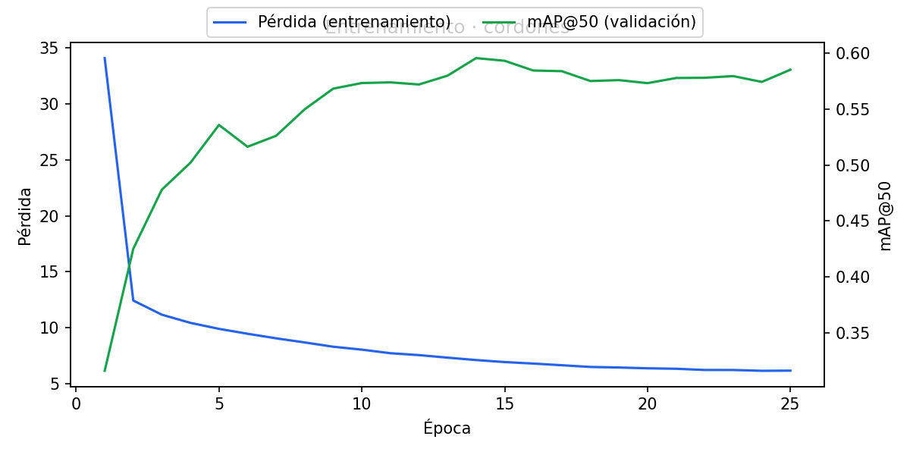

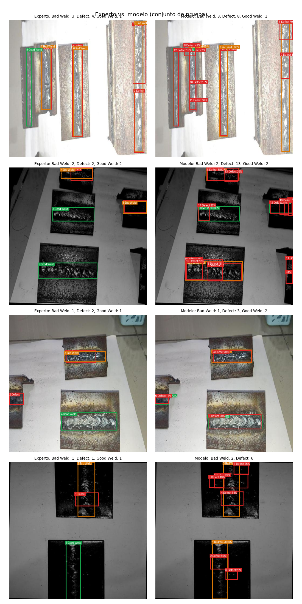

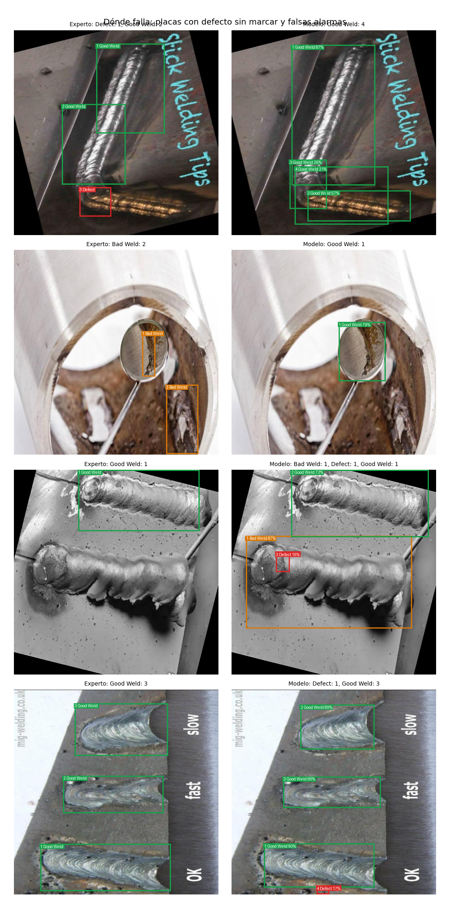

## Etapa 4 · App del inspector

### Paso 1: analizar una imagen (22-nov-2026)

Dos pestañas, **Radiografía** y **Foto del cordón**, cada una con su modelo. Subís la imagen y la app marca, cuenta y resume.

- **Tres niveles por hallazgo:** 🔴 posible defecto (el modelo está seguro), 🟡 revisar (duda) y 🟢 bien (cordón sano). El umbral del modelo sigue siendo el que asegura no perder defectos; el segundo umbral (provisorio, 0,5) solo decide si se pinta rojo o amarillo y nunca oculta nada. Responde a lo que se vio en cordones: muchas marcas de baja confianza.
- **Recuadros encimados:** si dos de la misma clase quedan uno casi entero dentro del otro, se muestra el más seguro.
- El color nunca va solo: cada recuadro lleva número, nombre en español y porcentaje (fuente con tildes incluida en el paquete).
- Resumen en una línea ("2 posibles defectos y 4 para revisar"), contadores y tabla de hallazgos. Aclara que la IA sugiere y decide el inspector.
- `scripts/instalar_modelos.py` copia los modelos desde los .zip de Kaggle a `models/`.

## Portero: ¿qué imagen es? (22-nov-2026)

Al probar la app, una foto de cordón subida en la pestaña de radiografías se analizó igual: cada detector busca defectos en cualquier cosa. Falta un control de entrada.

Notebook `portero_kaggle.ipynb`: clasificador **MobileNetV3-Small** (torchvision, BSD) con tres clases:
- **radiografia** y **foto_cordon**: los mismos datasets y la misma separación sin fuga de la Etapa 1.
- **otra**: 3.000 fotos comunes de Imagenette (Apache 2.0) y 1.500 radiografías de tórax (Kaggle, CC BY 4.0). Las de tórax son la trampa: son radiografías, pero no de soldadura.

Se mide exactitud por clase, matriz de confusión, cuántas de tórax pasan como radiografía de soldadura y cuántos errores tienen confianza alta. Por debajo de 60 % de confianza la app va a decir "no estoy seguro". La normalización va dentro del modelo exportado (recibe píxeles entre 0 y 1).

Al armar la exportación apareció el error de modo entrenamiento descripto arriba; se corrigió en los dos notebooks.
